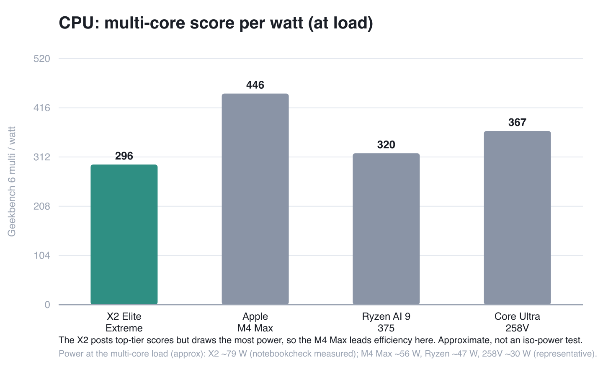
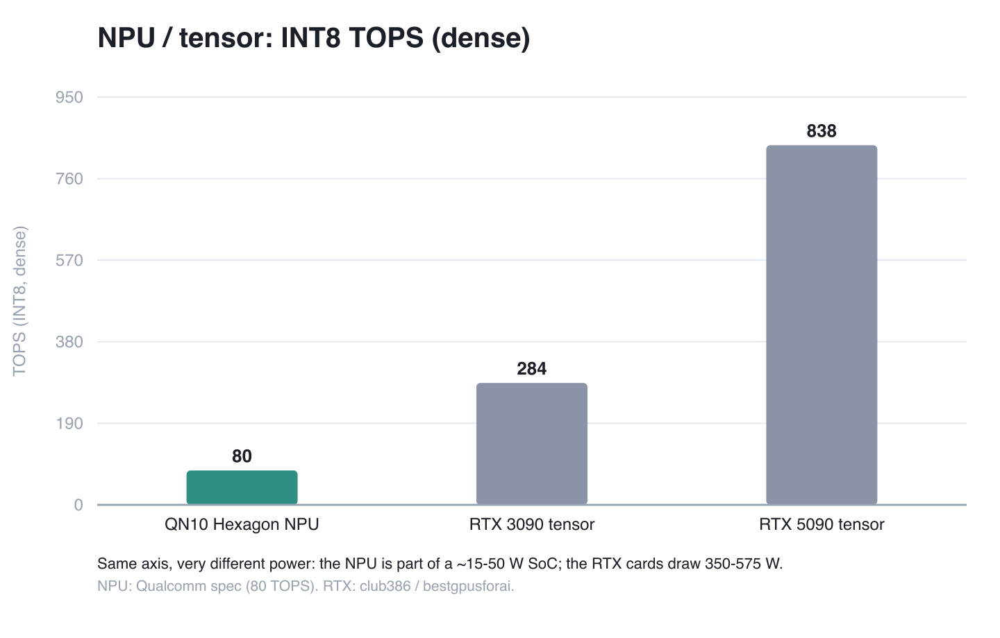
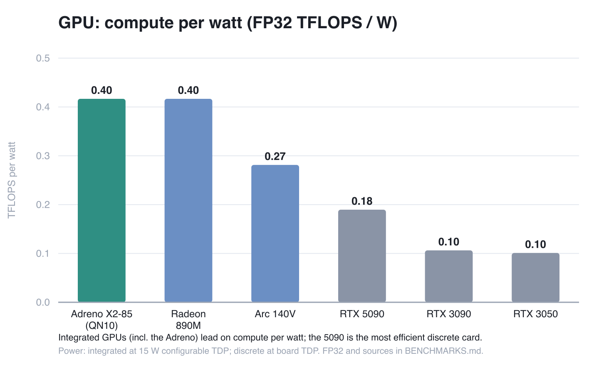

<!-- SPDX-License-Identifier: CC-BY-4.0 -->
# QN10: Linux on the ASUS Ascent QN10 (Snapdragon X2 Elite Extreme)

Experimental Debian/Linux hardware enablement for the ASUS Ascent QN10, a
Qualcomm Snapdragon X2 Elite Extreme mini-PC (platform "Glymur", SoC
SC8480XP, soc_id 698).

This repository holds the device tree, kernel patches, audio topology,
scripts, and the build and deployment howto. The matching kernel and audio
topology trees are published as forks:

- **[QN10-kernel](https://github.com/rcarback/QN10-kernel)** — fork of
  `qualcomm-linux/kernel` (qcom-next 7.4-rc1) with the ten QN10 patches and
  the board device tree on the `qn10` branch.
- **[QN10-audioreach-topology](https://github.com/rcarback/QN10-audioreach-topology)**
  — fork of `linux-msm/audioreach-topology` with the QN10 sound topology.

Start with **[AGENTS.md](AGENTS.md)** for a quick start and the USB image
deployment steps. See **[STATUS.md](STATUS.md)** for the full
hardware-by-hardware state and the reasons behind each conclusion.

See **[BENCHMARKS.md](BENCHMARKS.md)** for CPU, GPU, NPU, and
virtualization benchmarks, and how the QN10 compares to other processors and
to discrete GPUs.

## What works

Verified on the running system, kernel qcom-next 7.4-rc1 with the patches in
`patches/` and the device tree in `dts/`:

| Subsystem | State |
|-----------|-------|
| Boot from NVMe (Gen5 slot) | Works |
| Display / HDMI (3840x2160) | Works |
| GPU (Adreno X2-85, turnip/freedreno) | Works; full 1700 MHz under load, no throttle |
| Video decode and encode (iris, H.264) | Works; decode is bit-exact with software |
| NPU — CDSP compute (FastRPC) | Works |
| NPU — HTP AI accelerator (Hexagon V81) | Runs inference; see the socid-shim recipe |
| Audio: headset, speakers, mic | Works |
| Audio: HDMI/DisplayPort out | Works (topology + dai-link) |
| PCIe (NVMe at 16 GT/s) | Works |
| RTC (time of day) | Works |
| Ethernet (r8169) | Works |
| Wi-Fi (ath12k) | Works |
| Thermal sensing and throttling | Works (104 sensors) |
| USB (KVM, storage) | Works at USB 2 on the internal hub |
| Suspend / resume (s2idle) | Works; see the power-key note |

## How the QN10 compares

Full methodology and the measured Linux numbers are in
[BENCHMARKS.md](BENCHMARKS.md). The charts use published reviewer and vendor
figures for the comparison parts, cited there.

### CPU performance


| CPU | Geekbench 6 single | Geekbench 6 multi |
|-----|-------------------:|------------------:|
| Snapdragon X2 Elite Extreme (QN10 family) | ~4,080 | ~23,400 |
| Apple M4 Max (16-core) | ~3,900 | ~25,000 |
| AMD Ryzen AI 9 HX 375 | ~2,842 | ~15,030 |
| Intel Core Ultra 7 258V | ~2,724 | ~11,003 |

The X2 silicon wins single-core broadly, trails the M4 Max in multi-core, and
leads the current Intel and AMD laptop parts in both. On Linux the QN10 posts
a 7-zip rating near 133,500 MIPS, in high-end desktop 16-core range.

### CPU efficiency (compute per watt)



| CPU | GB6 multi | power at load | score / watt |
|-----|----------:|--------------:|-------------:|
| Apple M4 Max | ~25,000 | ~56 W | ~446 |
| Intel Core Ultra 7 258V | ~11,003 | ~30 W | ~367 |
| AMD Ryzen AI 9 HX 375 | ~15,030 | ~47 W | ~320 |
| Snapdragon X2 Elite Extreme | ~23,400 | ~79 W | ~296 |

The X2 posts top-tier absolute scores but draws the most power, so the Apple
M4 Max leads efficiency here; the X2 is competitive with AMD and Intel. Power
at load is approximate (the X2 figure is review-measured), not an iso-power
test.

### NPU and AI accelerator



| Accelerator | INT8 TOPS (dense) | Power class |
|-------------|------------------:|-------------|
| QN10 Hexagon NPU | 80 | part of a ~15-50 W SoC |
| RTX 3090 tensor | ~284 | 350 W |
| RTX 5090 tensor | ~838 | 575 W |

In INT8 the NPU is about 28 percent of a 3090 and 10 percent of a 5090, at a
fraction of the power, on-die, and usable from Linux through this work.

### GPU raw compute


| GPU | FP32 TFLOPS | Class |
|-----|------------:|-------|
| Adreno X2-85 (QN10) | ~6.0 (est.) | integrated |
| AMD Radeon 890M | 5.94 | integrated |
| Intel Arc 140V | 4.1 | integrated |
| RTX 3050 | 6.77 | entry discrete |
| RTX 3090 | 35.6 | flagship |
| RTX 5090 | 104.8 | flagship |

The Adreno X2-85 is a top-tier integrated GPU: on par with the Radeon 890M
and an entry RTX 3050, ahead of the Arc 140V. The flagships are a different
league. Qualcomm does not publish an FP32 figure; the ~6 is a community
estimate (nanoreview).

### GPU efficiency (compute per watt)



| GPU | FP32 / watt |
|-----|------------:|
| Adreno X2-85 (QN10) | ~0.40 |
| AMD Radeon 890M | ~0.40 |
| Intel Arc 140V | ~0.27 |
| RTX 5090 | ~0.18 |
| RTX 3090 | ~0.10 |
| RTX 3050 | ~0.10 |

Integrated GPUs, including the Adreno, deliver the most compute per watt;
among discrete cards the newer 5090 is the most efficient. Integrated power
uses the 15 W configurable TDP basis; discrete uses board TDP.

## What does not work, and why

Each item below is a firmware or platform limitation, not a missing driver.
The reasoning and the evidence are in [STATUS.md](STATUS.md).

- **TPM** — the firmware TPM runs inside the Qualcomm TEE (QTEE). The kernel
  has the `tpm_qcom` QTEE client driver, but QTEE on this unit reports the
  TPM service as "not available" to the non-secure world, so the driver has
  nothing to bind to. No change to a public driver reaches it.
- **Fan control** — the unit has no embedded controller exposed to the OS.
  The fan runs under firmware control based on temperature, the same way
  thermal throttling works.
- **Timer wake from suspend** — the charger firmware refuses the RTC alarm,
  so a timer cannot wake the machine. The power button wakes it.
- **GPU zap shader** — not needed. When Linux runs at EL2 the driver leaves
  secure mode directly, so no zap firmware is involved. The only loss is
  hardware DRM content protection (for example protected 4K streaming).

## Firmware is not included

The QN10 needs several signed Qualcomm/ASUS firmware files (ADSP, CDSP, iris
video, GPU, Wi-Fi board data). These are proprietary and are **not** in this
repository. Extract them from your own device's Windows partition. The
scripts `tools/kernel/` and `tools/npu/stage-dsp-libs.sh` document the file
names and the layout Linux expects. See [AGENTS.md](AGENTS.md).

## Repository layout

```
dts/         board device tree (glymur-asus-ascent-qn10.dts)
patches/     kernel patch series 0001-0010 (apply to qcom-next 7.4-rc1)
topology/    AudioReach sound topology source and build script
tools/
  kernel/    kernel build and install scripts
  audio/     mic/HDMI route service
  power/     suspend hooks, power-key fix, test scripts
  usb/       USB 3 fallback service and research notes
  media/     iris decode test
  gpu/       zap-shader trace tool
  npu/       HTP enablement recipe (socid-shim, build and run scripts)
```

## License

- Kernel patches (`patches/`) and the device tree (`dts/`): GPL-2.0, as in
  the Linux kernel. Each patch and the device tree carry their own
  SPDX headers.
- Topology source (`topology/`): BSD-3-Clause, matching AudioReach.
- Scripts in `tools/`: GPL-2.0-or-later unless a file states otherwise.
- Documentation (this file, `STATUS.md`, `AGENTS.md`): CC-BY-4.0.

This is unofficial hobbyist work. It is not endorsed by ASUS or Qualcomm,
and it comes with no warranty.
